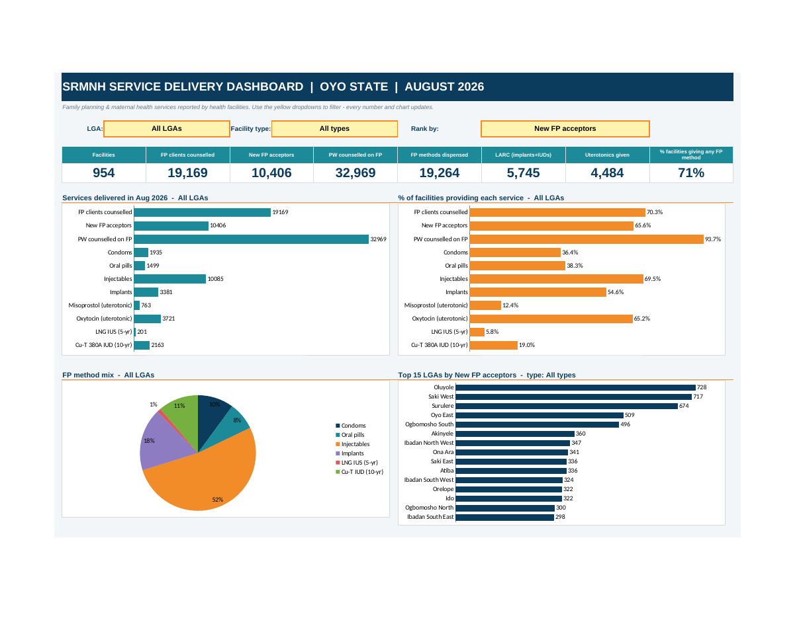

# SRMNH Service Delivery Analysis — Oyo State, August 2026

> Cleaning, analysing and visualising facility-level sexual, reproductive, maternal and newborn health (SRMNH) service data for 954 health facilities across all 33 LGAs in Oyo State, Nigeria, delivered as an interactive Excel dashboard.



---

## Table of Contents
1. [Problem Statement](#1-problem-statement)
2. [Dataset](#2-dataset)
3. [Tools Used](#3-tools-used)
4. [Methodology](#4-methodology)
5. [Dashboard](#5-dashboard)
6. [Key Insights](#6-key-insights)
7. [Recommendations](#7-recommendations)
8. [Limitations & Assumptions](#8-limitations--assumptions)
9. [Repository Structure](#9-repository-structure)
10. [How to Use](#10-how-to-use)
11. [Author](#11-author)

---

## 1. Problem Statement

Programme managers and decision makers need to know **which facilities and LGAs are delivering family planning (FP) and maternal health services, which services are being offered, and where the gaps are**. The monthly facility report for August 2026 contained this information, but in a form that was hard to use:

- A legacy `.xls` export with title rows, a grand-total row sitting inside the data, and inconsistent text (stray spaces, mixed capitalisation, typos).
- 954 facility rows × 11 indicators, with thousands of blank cells.
- No way to compare LGAs, facility types or services without manual filtering and re-calculation.

**Objective:** turn the raw export into a trustworthy, reconciled dataset and an interactive dashboard that answers:

1. How many clients were counselled, and how many accepted a method?
2. Which methods are being delivered, and in what mix?
3. What proportion of facilities provide each service?
4. Which LGAs, wards, facilities and facility types perform best, and where are the gaps?

## 2. Dataset

| Item | Detail |
|---|---|
| Source | *Proportion of Facilities providing SRMNH services*, August 2026 (`.xls` export) |
| Grain | One row per health facility |
| Coverage | 954 facilities · 324 wards · 33 LGAs (all LGAs in Oyo State) |
| Reporting period | August 2026 (single month) |

**Indicators (11):**

| Group | Indicators |
|---|---|
| FP counselling & uptake | FP clients counselled · New FP acceptors · Pregnant women (PW) counselled on FP |
| FP methods | Condoms · Oral pills · Injectables · Implants · IUD 5-yr LNG IUS (hormonal) · IUD 10-yr Cu-T 380A (copper) |
| Maternal health | Uterotonics in 3rd stage of labour: Misoprostol · Oxytocin |

> The data contains aggregate facility counts only — no patient-level or personally identifiable information.

## 3. Tools Used

| Tool | Purpose |
|---|---|
| **Python 3 (pandas)** | Profiling the data, cleaning, standardising names, deriving facility type, running quality checks |
| **openpyxl** | Building the Excel workbook: formulas, data validation dropdowns, conditional formatting, charts |
| **LibreOffice (headless)** | Converting `.xls` → `.xlsx`, recalculating formulas and checking for errors, rendering a preview |
| **Microsoft Excel** | Final delivery: interactive dashboard (dropdown filters, live formulas, native charts) |
| **Claude (Anthropic)** | AI assistant used to plan, generate and verify the analysis and this report |

Excel functions used: `SUMIFS`, `COUNTIFS`, `INDEX/MATCH`, `LARGE`, `IFERROR`, `COUNTIF` wildcards, data validation lists, conditional formatting (colour scales, data bars).

## 4. Methodology

### Step 1 — Ingest & profile
- Converted the legacy `.xls` to `.xlsx` and loaded it with pandas.
- Located the true header row (row 3) and profiled every column: data types, missing values, ranges, duplicates.

### Step 2 — Clean
| Issue found | Action |
|---|---|
| 2 title/blank rows above the header | Removed |
| `GRAND TOTAL` row inside the data | Removed from the data (would double-count) and **kept as a control total** |
| Extra / non-breaking spaces | Trimmed and collapsed: all 954 LGA cells, 949 Ward cells, 69 facility names |
| Inconsistent capitalisation and typos (`Hosptal`, `Clinc`, `Center`) | Standardised – 28 facility names changed |
| 5,431 blank indicator cells | Set to `0` (assumption: blank = service not reported/provided that month) |
| Duplicate records (LGA + Ward + Facility) | Checked – none found |
| Data types / negatives / text in numeric columns | Checked – none found |
| Logic check: new acceptors > clients counselled | Checked – no violations |

### Step 3 — Enrich
Added derived fields:
- **Facility Type** (Hospital, Primary Health Centre, Health Post, Clinic/Maternity, Medical Centre/Other) – derived from keywords in the facility name.
- **FP Methods Total** = condoms + oral pills + injectables + implants + LNG IUS + Cu-T IUD.
- **Uterotonics Total** = misoprostol + oxytocin.

### Step 4 — Validate (reconciliation)
Every one of the 11 indicator totals and the facility count in the cleaned data matches the original `GRAND TOTAL` row exactly (difference = 0). See the `Cleaning_Log` sheet.

### Step 5 — Analyse
- Totals and "% of facilities providing" each service (a facility "provides" a service if it reported > 0).
- LGA ranking and LGA × indicator summary.
- Facility-type comparison, method mix, and concentration analysis.

### Step 6 — Build the dashboard
All figures are **live formulas** driven by three dropdown filters, so the dashboard recalculates instantly with no macros. Zero formula errors were reported on a full recalculation (3,700+ formulas).

## 5. Dashboard

**Filters (dropdowns):** LGA · Facility type · Rank-by metric (13 options)

**Components**
- 8 KPI cards: facilities, FP clients counselled, new acceptors, PW counselled on FP, methods dispensed, long-acting methods (implants + IUDs), uterotonics given, % of facilities giving any FP method
- Services delivered (bar) and % of facilities providing each service (bar)
- FP method mix (pie)
- Top 15 LGAs by the chosen metric (bar)
- Chosen metric by facility type (bar)
- Top 10 facilities by the chosen metric (table with data bars)
- Auto-generated insight sentences that update with the filters

**Supporting sheets:** `LGA_Summary` (all 33 LGAs × all indicators, heat-mapped) · `Cleaning_Log` · `Clean_Data` · `Raw_Data` (untouched original) · `Calc` (formula engine)

## 6. Key Insights

*All figures are for August 2026, Oyo State, all facilities.*

### Overall volumes
| Indicator | Total |
|---|---|
| FP clients counselled | 19,169 |
| New FP acceptors | 10,406 |
| Pregnant women counselled on FP | 32,969 |
| FP methods dispensed (all 6 methods) | 19,264 |
| Uterotonics given (oxytocin + misoprostol) | 4,484 |

### 1. Counselling of pregnant women is nearly universal; method provision is not
- **94%** of facilities counselled pregnant women on FP, and **70%** counselled FP clients.
- Yet only **71%** dispensed at least one FP method — **273 facilities (29%) dispensed none**.

### 2. Injectables dominate the method mix; long-acting options are thin
- Injectables = **52%** of methods dispensed; implants and IUDs together = **30%** (5,745); condoms and oral pills together only ~18%.
- Reach differs sharply by method: injectables are offered by **69%** of facilities, implants by **55%**, Cu-T IUD by **19%**, and the hormonal LNG IUS by only **6%**.

### 3. Primary Health Centres carry the programme
| Facility type | Share of facilities | Share of new acceptors | Avg. new acceptors / facility | % giving any FP method |
|---|---|---|---|---|
| Primary Health Centre | 62% | **84%** | **14.9** | 89% |
| Health Post | 3% | 3% | 11.6 | 92% |
| Hospital | 15% | 7% | 5.1 | 43% |
| Clinic / Maternity | 16% | 5% | 3.6 | 41% |
| Medical Centre / Other | 5% | 1% | 1.5 | 27% |

Hospitals, clinics and private medical centres together make up about a third of facilities but deliver only ~13% of new acceptors, and fewer than half dispense any method.

### 4. Large geographic variation between LGAs
- **Top LGAs by new acceptors:** Oluyole (728), Saki West (717), Surulere (674).
- **Highest average new acceptors per facility:** Surulere (24.1), Ogbomosho South (21.6), Oyo East (21.2).
- **Lowest average per facility:** Ori Ire (4.9), Olorunsogo (5.3), Egbeda (5.4).
- **Share of facilities dispensing any method** ranges from **100%** (Ibarapa North) and 91% (Ogbomosho South) down to just **43% in Akinyele** — notable because Akinyele has 51 facilities, the second most of any LGA.

### 5. Service deserts for specific methods
- **6 LGAs recorded zero hormonal LNG IUS**: Ibarapa Central, Iseyin, Itesiwaju, Ogbomosho North, Ogbomosho South, Ori Ire.
- **4 LGAs recorded no misoprostol in any facility**: Itesiwaju, Ogo Oluwa, Ona Ara, Surulere.
- **Oxytocin** (83% of uterotonics) is offered by 65% of facilities overall, but only ~31% in Ibadan South West and ~36% in Surulere.

### 6. Many facilities show no activity
- **328 facilities (34%)** recorded zero new FP acceptors, against a median of 5 and a mean of 10.9 per facility, which indicates a long tail of low or non-reporting sites.
- Output is not concentrated in a few outliers: the top 10 facilities account for under 9% of acceptors, and the top 10% of facilities (95) for ~47%.

## 7. Recommendations

> Recommendations follow from the data above and should be validated with programme and supervisory knowledge of each LGA.

1. **Verify the "zero" facilities first.** Review the 273 facilities that dispensed no FP method and the 328 with no new acceptors to separate *true non-provision* (stock-outs, untrained staff, no commodities) from *under-reporting* (late, missing or incomplete submissions). Treat these as two different action lists.
2. **Prioritise low-performing LGAs for supportive supervision** — start with Akinyele (43% of facilities dispensing any method despite a large facility base), then Ogbomosho North, Iwajowa, Irepo and Ogo Oluwa.
3. **Bring hospitals and private clinics into FP delivery.** They are a third of facilities but deliver few acceptors; engage them through integration of FP into routine services, provider orientation, commodity access and reporting alignment.
4. **Expand long-acting reversible contraception (LARC).** Target training and commodity supply for implants and IUDs, especially the 6 LGAs with no LNG IUS recorded and LGAs where Cu-T/implant availability is low, to widen method choice beyond injectables.
5. **Close the misoprostol and oxytocin gaps.** Check supply chain and provider capacity in the 4 LGAs with no misoprostol and in LGAs with low oxytocin coverage (e.g. Ibadan South West, Surulere); these are core maternal-health commodities.
6. **Replicate what works.** Study the practices of high-yield LGAs (Surulere, Ogbomosho South, Oyo East) and of the best-performing PHCs to build peer-learning and mentorship.
7. **Strengthen data quality at source.** Standardise facility names and facility-type codes, replace blanks with explicit zeros plus a "reported / not reported" flag, and use dropdown-based entry in the reporting template to avoid the cleaning work done here.
8. **Track trends.** Repeat this analysis monthly to monitor change in the proportion of facilities providing each service and in new acceptors, ideally with population or expected-need denominators.

## 8. Limitations & Assumptions

- **Blank = 0.** The source does not distinguish "not provided" from "not reported". All blanks (5,431 cells) were treated as 0, so "% of facilities providing" may be understated where facilities simply did not report.
- **"Provides a service" = reported value > 0 in August 2026.** A facility that offers a service but had no clients that month is counted as not providing.
- **Single month only.** No trend or seasonality can be inferred.
- **No population denominators.** Comparisons are on counts, per-facility averages and facility proportions, not on coverage of the population in need.
- **Facility Type is derived from name keywords**, so some facilities may be misclassified; the "Medical Centre / Other" group is a catch-all.
- **Methods dispensed include continuing users**, so it is not comparable to "New FP acceptors."
- Findings describe **what was reported**; causes (stock-outs, staffing, reporting gaps) need field verification.

## 9. Repository Structure

```
├── README.md                          # This report
├── dashboard_preview.png              # Screenshot of the dashboard
├── SRMNH_Dashboard_Aug2026.xlsx       # Cleaned data + interactive dashboard
├── data/
│   └── Proportion_of_Facilities_providing_SRMNH_services_AUGUST_2026.xls   # Original (optional)
└── scripts/
    └── build.py                       # Python script that cleans the data and builds the workbook (optional)
```

**Workbook sheets**

| Sheet | Contents |
|---|---|
| `Dashboard` | Interactive dashboard (start here) |
| `Clean_Data` | Cleaned, analysis-ready table with derived fields |
| `LGA_Summary` | All LGAs × all indicators, heat-mapped |
| `Cleaning_Log` | Every cleaning step plus reconciliation to the source totals |
| `Calc` | Formula engine behind the dashboard (do not edit) |
| `Raw_Data` | Untouched copy of the original data for audit |

## 10. How to Use

1. Download `SRMNH_Dashboard_Aug2026.xlsx` and open it in Excel (desktop recommended).
2. Go to the **Dashboard** sheet.
3. Use the yellow dropdowns to filter by **LGA**, **Facility type** and **Rank by** metric. KPIs, charts, the top-10 table and insights all update.
4. Review `Cleaning_Log` to see how the data was prepared and reconciled.

**To refresh with new data:** replace the rows in `Clean_Data` (keeping the same column order), update the facility range if the row count changes, and re-check the control totals in `Cleaning_Log`.

## 11. Author

**AFOLABI FAVOUR DANIEL** — Data Analyst
[LinkedIn](https://www.linkedin.com/in/afolabi-favour-daniel-a08768298) · [Email](afolabifavour247@gmail.com) · [Website] (https://afolabi-favour-daniel.netlify.app/)

*Data source: Oyo State SRMNH facility reporting, August 2026.*
